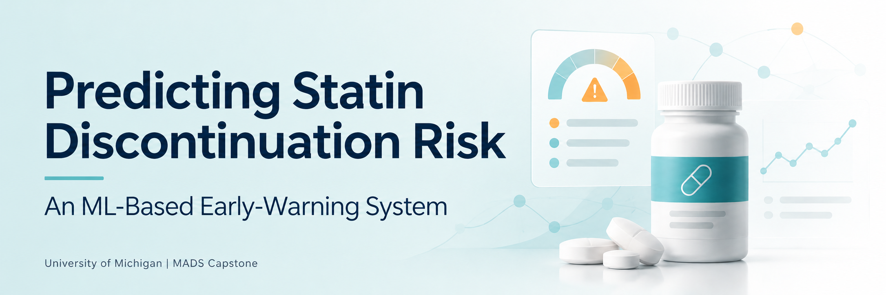

# Predicting Statin Discontinuation Risk

An early-warning system that predicts which statin users are at risk of stopping their medication, explains what drives each patient's risk, and drafts a suggested next action for a pharmacist or care manager to review.

> ⚠️ **Prototype** for the University of Michigan Master of Applied Data Science capstone (SIADS 699).
> Not for clinical or coverage decisions.

---

## How It Works

1. **Predict:** a model scores each patient's risk of stopping statins.
2. **Explain:** SHAP shows the main drivers of that risk (for example, high out-of-pocket cost).
3. **Retrieve:** a RAG pipeline finds relevant guidance from public clinical documents.
4. **Draft:** an agent suggests a next action, with citations.
5. **Review:** a person approves, edits, or rejects it in the Streamlit app.

---

## Directory Structure

```
├── README.md
├── requirements.txt
├── .gitignore
├── .claude/
│   └── agents/          ← Claude Code subagents
├── agent/               ← RAG and next-action agent code
├── app/                 ← Streamlit app
├── data/                ← not pushed to GitHub (blocked in .gitignore)
│   ├── raw/             ← original MEPS zip files, never edited
│   ├── interim/         ← partly cleaned data
│   └── processed/       ← analysis-ready data
├── docs/                ← project documentation
│   └── meps_sources.md
├── models/              ← saved trained models
├── notebooks/
│   ├── 01_run_pipeline.ipynb
│   ├── 02_eda.ipynb
│   ├── 03_modeling.ipynb
│   ├── 04_model_evaluation.ipynb
│   ├── 05_rag.ipynb
│   ├── 06_agent.ipynb
│   └── 07_insights_visualizations.ipynb
├── report/              ← final report
├── results/             ← metrics, SHAP outputs, charts
└── src/
    └── download_meps.py ← downloads the MEPS files to data/raw/
```


---

## Notebooks

| Notebook | What it does |
|----------|--------------|
| 01_run_pipeline | Links the MEPS files and builds the analysis dataset |
| 02_eda | Explores the data |
| 03_modeling | Trains the logistic regression and gradient boosting models |
| 04_model_evaluation | Checks performance, calibration, and fairness across subgroups |
| 05_rag | Builds the guidance search (RAG) |
| 06_agent | Drafts suggested next actions with LangGraph |
| 07_insights_visualizations | Charts and key findings |

## Documentation

| Document | What it covers |
|----------|----------------|
| [MEPS data sources](docs/meps_sources.md) | Files we use and their download links |
| [Data dictionary](docs/data_dictionary.md) | Variables we use and what they mean |
| [Data understanding](docs/data_understanding.md) | Plain-English guide to MEPS |
| [Data assessment](docs/data_assessment.md) | Findings from first exploring the data |
| [Cohort and label](docs/cohort_and_label.md) | Who is in the study and what "discontinued" means |
| [RAG corpus sources](docs/corpus_sources.md) | Guidance documents used by the RAG pipeline |
| [System architecture](docs/architecture.md) | How the model, RAG, agent, and app connect |
| [Agent setup](docs/agent_setup.md) | How to run the Claude Code subagents |
| [Use of AI tools](docs/ai_use.md) | How the team used AI tools |

---

## Data

We use public **MEPS (Medical Expenditure Panel Survey)** data from the Agency for Healthcare Research and Quality (AHRQ): Panel 27 (2022–2023).

- The data is **not stored in this repo**.
- The file list and download links are in [MEPS data sources](docs/meps_sources.md).
- The download script saves files to `data/raw/` on your computer. These files are never edited.

---

## Requirements

- Python 3.10+ *(TODO: confirm version with team)*
- Packages listed in `requirements.txt`, including pandas, scikit-learn, XGBoost, SHAP, LangGraph, and Streamlit

Check your Python version:

```
python --version
```

---

## Getting Started

1. **Clone the repo**
   ```
   git clone https://github.com/siads699-group20/statin-discontinuation.git
   cd statin-discontinuation
   ```
2. **Install packages**
   ```
   pip install -r requirements.txt
   ```
3. **Download the data**
   ```
   python scripts/download_meps.py
   ```
4. **Run the notebooks in order**, starting with `notebooks/01_run_pipeline.ipynb`

---

## Results

Coming soon.

---

## Team

SIADS 699 Group 20: Maria Febus, [Teammate 2], [Teammate 3], [Teammate 4]

## Use of AI Tools

See [Use of AI tools](docs/ai_use.md).

## License

TODO: to be decided by the team.
