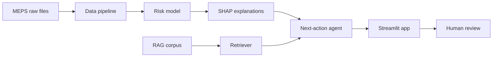

# System Architecture

**Purpose:** Shows how the model, RAG pipeline, agent, and app connect, and what passes between them.
**Owner:** TBD
**Last updated:** YYYY-MM-DD

---

## Overview

## Handoffs

| From | To | What passes | Format |
|------|----|-------------|--------|
| Data pipeline | Model | Analysis-ready dataset | Parquet |
| SHAP | Agent | Patient risk score and top drivers | JSON |
| Retriever | Agent | Relevant passages with sources | Python `retrieve()` function |
| Agent | App | Drafted next action with citations | TODO |

## Key rule

Nothing happens automatically. A person approves, edits, or rejects every suggestion.
